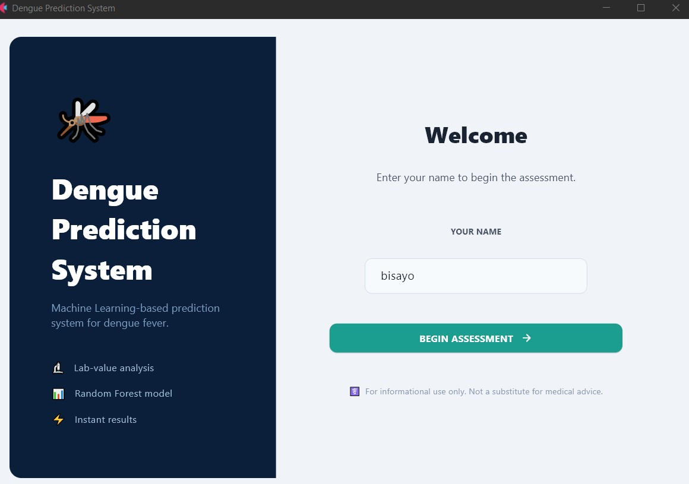
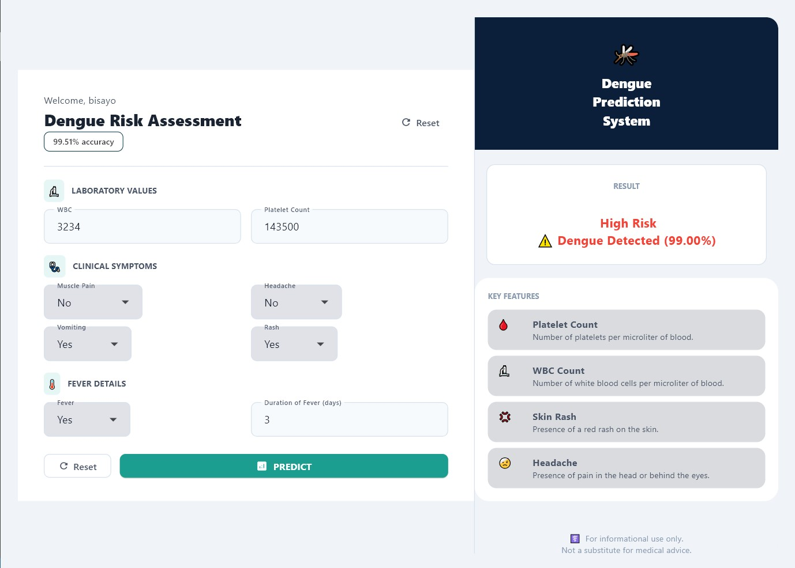

# Dengue Fever Prediction System

A machine-learning-based desktop application designed to predict the likelihood of dengue fever using clinical and hematological information.

The system combines feature selection, machine-learning classification and a graphical user interface built with Python and Flet.

## Overview

This project explores the application of machine learning in early dengue fever prediction using clinical and hematological data.

Three feature-selection techniques and three classification algorithms were investigated to identify a suitable model for the prediction task. The selected Random Forest model was subsequently integrated into a desktop application that accepts patient information and displays a prediction.

## Features

- Desktop graphical interface built with Flet.
- Clinical and hematological input collection.
- Machine-learning-based dengue prediction.
- Input validation.
- Result display with estimated risk categories.
- Reset functionality for new assessments.
- Saved machine-learning model integrated into the application.

## Technologies Used

- **Python** – Main programming language.
- **Flet** – Desktop application interface.
- **NumPy** – Numerical data processing.
- **Pandas** – Dataset manipulation.
- **Scikit-learn** – Machine-learning algorithms and feature selection.
- **Matplotlib and Seaborn** – Data visualization.
- **Joblib** – Model serialization and loading.
- **Jupyter Notebook** – Model experimentation and evaluation.

## Machine Learning Methodology

### Dataset Preparation

The project uses a structured clinical and hematological dengue dataset. Data preparation included categorical encoding, one-hot encoding of location information, removal of the patient ID column and preparation of the target variable.

### Feature Selection

Three feature-selection techniques were investigated:

1. Chi-square (Chi2)
2. Pearson Correlation
3. Mutual Information

Each technique was used to select eight features for model experimentation.

### Classification Algorithms

Three classification algorithms were compared:

- Random Forest
- Logistic Regression
- Support Vector Machine (SVM)

Standard scaling was applied to the Logistic Regression and SVM experiments.

### Model Evaluation

The models were evaluated using:

- Accuracy
- Precision
- Recall
- F1-score
- Classification reports
- Confusion matrices

## Experimental Results

The following table presents the reported accuracy scores from the experiments.

| Feature Selection | Random Forest | Logistic Regression | SVM |
|---|---:|---:|---:|
| Chi-square | **99.51%** | 99.02% | 99.02% |
| Pearson | 99.02% | 99.02% | 99.02% |
| Mutual Information | **99.51%** | 99.02% | 99.02% |

The Chi-square and Random Forest combination was selected for integration into the desktop application.

*These are experimental results from the original evaluation. They should not be interpreted as evidence of clinical accuracy or real-world diagnostic performance.*

## Application Inputs

The application collects eight input features:

1. White Blood Cell (WBC) count
2. Platelet count
3. Muscle pain
4. Fever
5. Headache
6. Fever duration
7. Vomiting
8. Skin rash

The trained model processes these inputs and returns a dengue prediction with an accompanying risk indication.

## Project Structure

```text
dengue-prediction-system/
│
├── images/
│
├── src/
│   ├── assets/
│   ├── extras/
│   ├── dengue_model.pkl
│   └── main.py
│
├── training/
│   ├── dengue_clinical_dataset.csv
│   ├── dengue_model.pkl
│   ├── feature_testing3.ipynb
│   ├── pearson.ipynb
│   ├── visualization.py
│   
│
├── .gitignore
├── pyproject.toml
└── README.md
```

## Installation and Setup

### Prerequisites

- Python 3.10 or later
- Git

### 1. Clone the repository

```bash
git clone https://github.com/felixbisayo/dengue-prediction-system.git
```

### 2. Navigate into the project directory

```bash
cd dengue-prediction-system
```

### 3. Create a virtual environment

```bash
python -m venv .venv
```

### 4. Activate the environment

Windows:

```bash
.venv\Scripts\activate
```

### 5. Install dependencies

```bash
pip install -e .
```

### 6. Run the application

```bash
flet run src/main.py
```

## Screenshots

### Landing Page


### Assessment Screen


## Dataset and Acknowledgements

This project uses the **Structured Clinical and Hematological Dataset for Early Dengue Diagnosis in Bangladesh**, published by Rachin and Kholilullah (2025) on Mendeley Data.

**Dataset citation:**

Rachin, N. A., & Kholilullah, I. (2025). *Structured Clinical and Hematological Dataset for Early Dengue Diagnosis in Bangladesh* (Version 1). Mendeley Data. https://doi.org/10.17632/673swz9tb4.1

The dataset is acknowledged as the primary data source used for model development and experimentation.

## Limitations and Disclaimer

This project is an academic and experimental machine-learning application. It has not been clinically validated and must not be used as a substitute for professional medical diagnosis, laboratory testing or treatment.

Its predictions are based on the dataset and features used during development. Performance on other populations or real-world clinical data may differ.

## Author

**Bisayo Felix**

B.Sc. Computer Science

GitHub: [@felixbisayo](https://github.com/felixbisayo)
Email: bisayoawopetu@gmail.com